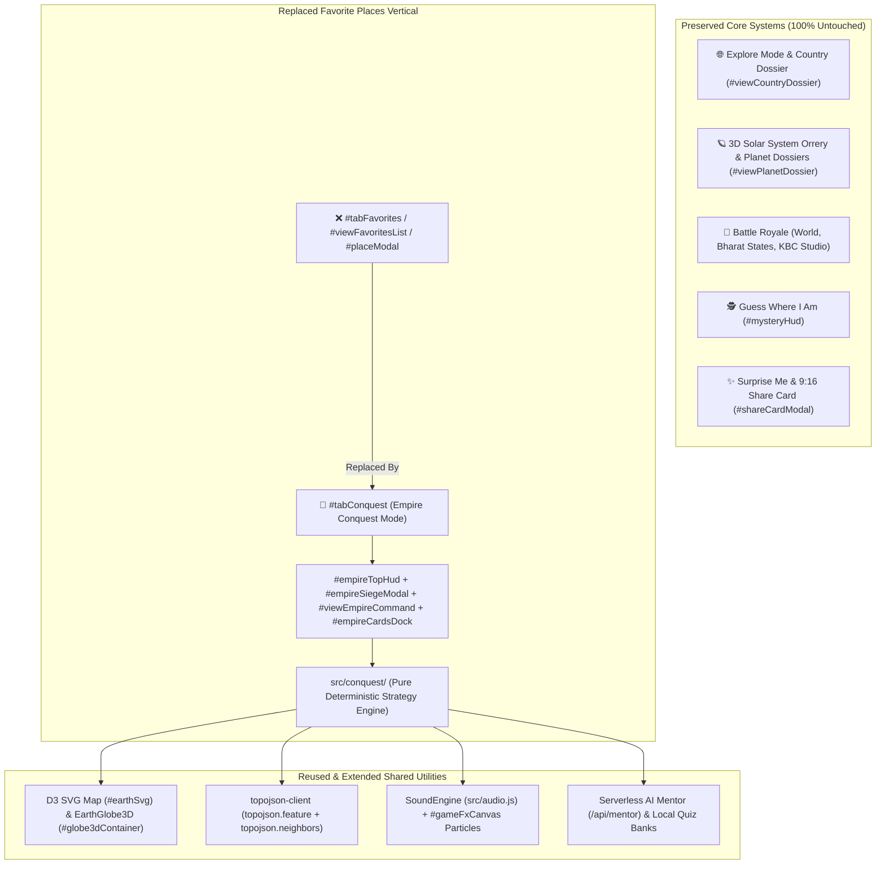
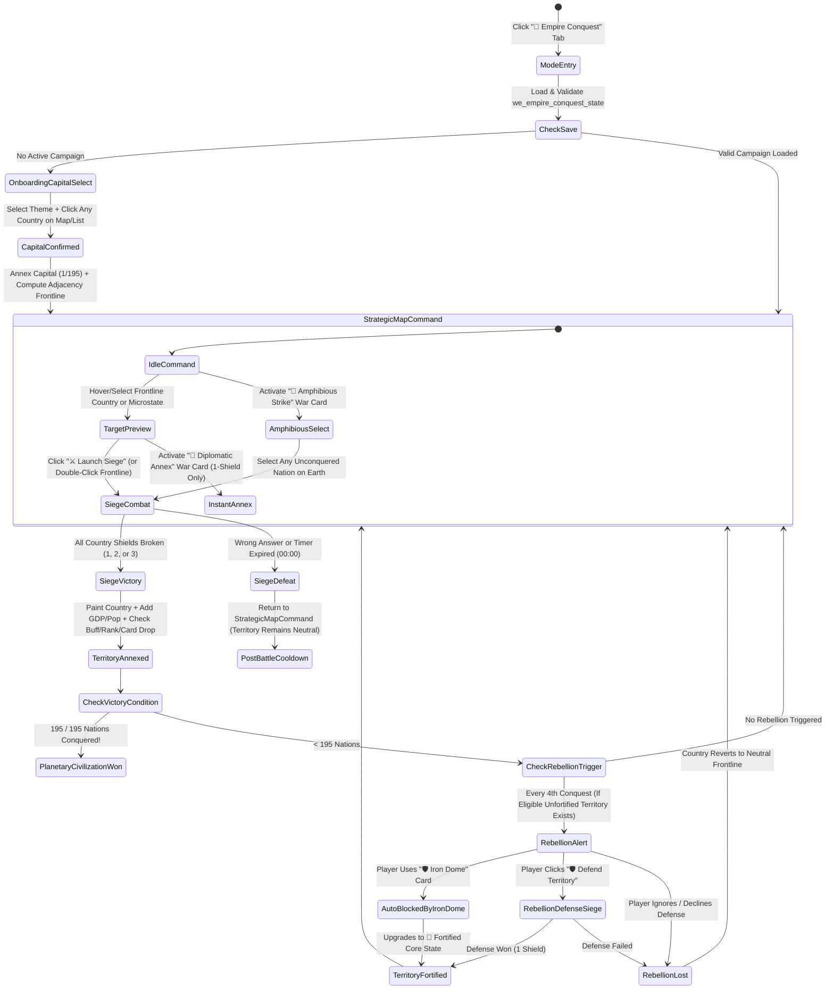
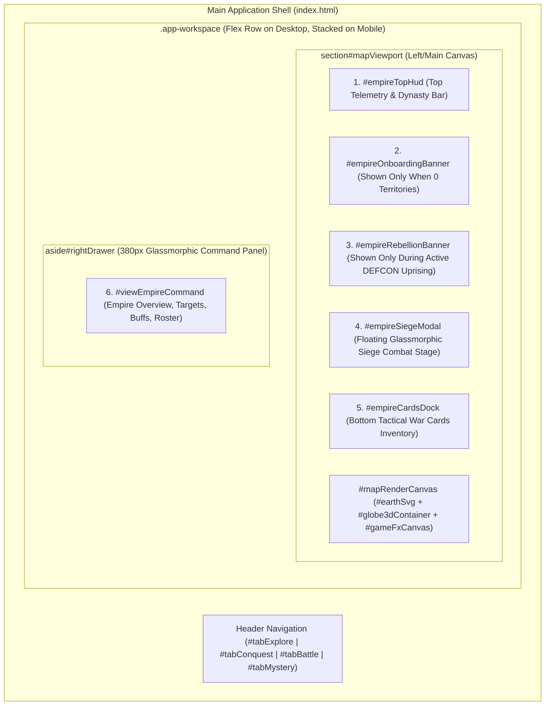
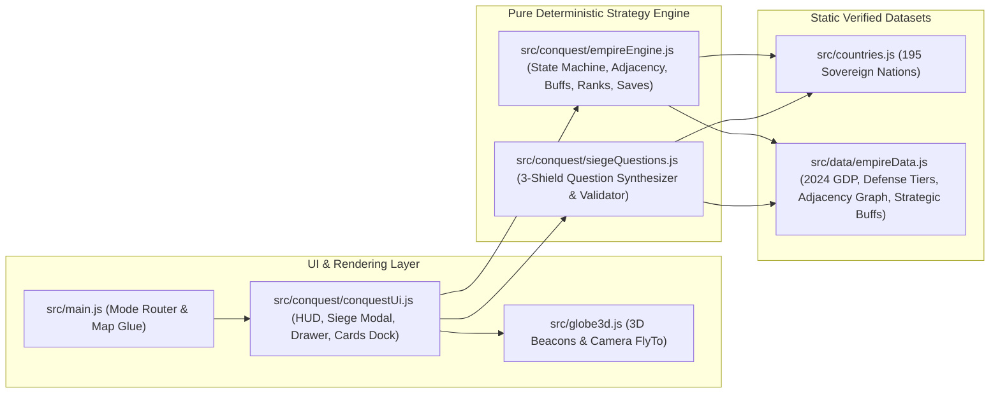

# 👑 WORLD EXPLORER — EMPIRE CONQUEST
## Phase 0: Product Revamp, Technical Audit & System Architecture Blueprint

> **Document Status:** `PHASE 0 — ARCHITECTURE & PLANNING ONLY (NO IMPLEMENTATION YET)`
> **Target Repository:** `d:/OLD_HP_PC_BACKUP/e/antigravity/vibe/world-explorer`
> **Scope Constraint:** Replace **only** the existing Favorite Places experience (`#tabFavorites`, `#favoritesFilterDock`, `#viewFavoritesList`, `#placeModal`, `#suggestPlaceModal`, and `src/data/favorites.js` integration) with **👑 World Domination: Empire Conquest**. All other experiences (`🌐 Explore`, `🪐 Solar System Orrery`, `🧠 Battle Royale`, `🕵️ Guess Where`, `✨ Surprise Me`) remain 100% intact and uncompromised.

---

## 1. Executive Summary

**World Explorer: The Earth Playground & Solar System Orrery** is a high-performance vanilla ES module web application combining a Three.js heliocentric solar system and photorealistic 3D Earth (`src/globe3d.js`) with a D3.js/TopoJSON interactive cartographic projection (`src/main.js`).

While the existing **Explore**, **Battle Royale** (World, Bharat States, KBC Studio), and **Guess Where** modes have recently undergone full architectural UI/UX overhauls, the **❤️ Favorite Places** tab (`#tabFavorites`) remains a static community-voting list with low retention and weak strategic engagement.

This blueprint specifies the complete **Phase 0 technical audit, game-systems engineering design, 2D/3D visual synchronization architecture, and UI/UX layout plan** to replace `#tabFavorites` with **👑 World Domination: Empire Conquest**—a deterministic, local-first grand-strategy geography conquest campaign where players establish a capital, annex neighboring territories through 1-to-3 Shield Blitz Sieges, absorb real-world GDP and strategic geopolitical buffs, defend against DEFCON rebellions, and evolve across 6 Dynasty Ranks toward unifying all registered sovereign nations.

---

## 2. Verified Existing Architecture (`[VERIFIED]`)

Every finding below was verified directly from the repository source files on `2026-10-13`.

### 2.1 Installed Dependencies & Build Pipeline (`[VERIFIED]`)
From [`package.json`](file:///d:/OLD_HP_PC_BACKUP/e/antigravity/vibe/world-explorer/package.json):
| Package | Declared Version | Role in Application |
| :--- | :--- | :--- |
| `three` | `^0.186.1` | 3D Solar System Orrery, custom GLSL Sun/Earth/Saturn shaders, `EffectComposer` (`RenderPass`, `SMAAPass`, `UnrealBloomPass`, `FilmPass`) |
| `d3` | `^7.9.0` | 2D Natural Earth (`d3.geoNaturalEarth1`) & Orthographic (`d3.geoOrthographic`) SVG map rendering, zoom/pan transforms, solar terminator calculation |
| `topojson-client` | `^3.1.0` | Converts `world-atlas@2/countries-110m.json` TopoJSON arcs into GeoJSON polygon features (`topojson.feature`) |
| `@neondatabase/serverless` | `^1.2.0` | Used in Vercel Serverless functions (`api/quiz.js`, `api/places.js`) with graceful local fallback |
| `vite` | `^8.3.0` | ES module bundler and dev server (`http://localhost:5173`) |
| `playwright` | `^1.63.0` | Headless browser automation & visual verification |

### 2.2 Application Bootstrap & Mode Router (`[VERIFIED]`)
- **Entry Point:** [`index.html`](file:///d:/OLD_HP_PC_BACKUP/e/antigravity/vibe/world-explorer/index.html#L728) loads `/src/main.js` as a native ES module.
- **Bootstrap Sequence (`boot()` in [`src/main.js:116-209`](file:///d:/OLD_HP_PC_BACKUP/e/antigravity/vibe/world-explorer/src/main.js#L116-L209)):**
  1. Indexes `COUNTRIES` from [`src/countries.js`](file:///d:/OLD_HP_PC_BACKUP/e/antigravity/vibe/world-explorer/src/countries.js) into `countryMap` (by ISO-2 `code`) and `countryByNameLower` (by lowercase `name`).
  2. Fetches `https://cdn.jsdelivr.net/npm/world-atlas@2/countries-110m.json` and converts `worldData.objects.countries` into `countriesGeo`.
  3. Fetches `/data/india-states.json` for Indian state boundaries (`indiaStatesGeo`).
  4. Links `countriesGeo.features` to `COUNTRIES` objects via `NAME_ALIASES` and substring fallback (`src/main.js:147-168`).
  5. Initializes D3 map (`initD3Map()`), 2D canvas particle FX engine (`initGameFxCanvas()`), navigation tabs (`initNavigation()`), search, quick jump, planetary explorer, favorites (`initFavoritesSystem()`, `initSuggestPlaceSystem()`), Battle Royale (`initBattleRoyale()`), and Mystery Game (`initMysteryGame()`).
  6. Dismisses `#loadingScreen` after 2500ms and auto-triggers `#btnGlobeView` + `globe3dInstance.viewWholeSolarSystem()` at 2750ms if still in `explore` mode.
- **Tab Navigation (`handleModeSwitch(mode)` in [`src/main.js:2221-2273`](file:///d:/OLD_HP_PC_BACKUP/e/antigravity/vibe/world-explorer/src/main.js#L2221-L2273)):**
  - Switches `currentMode` between `'explore' | 'favorites' | 'battle' | 'mystery'`.
  - Toggles `document.body.classList` (`mode-battle`, `submode-kbc`, `mode-mystery`).
  - Switches right drawer panels via `showDrawerSection(viewId)` (`#viewCountryDossier`, `#viewPlanetDossier`, `#viewFavoritesList`).

### 2.3 Complete Lifecycle of `#tabFavorites` (To Be Replaced) (`[VERIFIED]`)
The existing Favorite Places system spans the following verified touchpoints:
1. **Header Navigation Button ([`index.html:46-50`](file:///d:/OLD_HP_PC_BACKUP/e/antigravity/vibe/world-explorer/index.html#L46-L50)):** `#tabFavorites` (`data-mode="favorites"`).
2. **Map Viewport Filter Bar ([`index.html:155-160`](file:///d:/OLD_HP_PC_BACKUP/e/antigravity/vibe/world-explorer/index.html#L155-L160)):** `#favoritesFilterDock` and `#favFilterScroll`.
3. **Right Drawer View ([`index.html:460-485`](file:///d:/OLD_HP_PC_BACKUP/e/antigravity/vibe/world-explorer/index.html#L460-L485)):** `#viewFavoritesList` containing `#btnOpenSuggestModal`, `#favSearchInput`, `#favRegionBar`, and `#favLeaderboard`.
4. **Dialogs ([`index.html:515-557`](file:///d:/OLD_HP_PC_BACKUP/e/antigravity/vibe/world-explorer/index.html#L515-L557) & [`index.html:595-647`](file:///d:/OLD_HP_PC_BACKUP/e/antigravity/vibe/world-explorer/index.html#L595-L647)):** `#placeModal` (voting & details) and `#suggestPlaceModal` (form submission).
5. **State & Storage Keys ([`src/main.js:33-51`](file:///d:/OLD_HP_PC_BACKUP/e/antigravity/vibe/world-explorer/src/main.js#L33-L51)):** `we_user_voted_places`, `we_custom_suggested_places`, `we_persisted_place_votes`.
6. **Functions in [`src/main.js:685-1117`](file:///d:/OLD_HP_PC_BACKUP/e/antigravity/vibe/world-explorer/src/main.js#L685-L1117):** `loadPersistedVotes`, `savePersistedVote`, `syncGlobalVotes`, `initFavoritesSystem`, `getFilteredFavorites`, `renderFavoriteMarkers`, `renderFavoritesLeaderboard`, `openPlaceModal`, `initSuggestPlaceSystem`.
7. **3D Globe Markers Integration ([`src/main.js:2090-2093`](file:///d:/OLD_HP_PC_BACKUP/e/antigravity/vibe/world-explorer/src/main.js#L2090-L2093), [`2254`](file:///d:/OLD_HP_PC_BACKUP/e/antigravity/vibe/world-explorer/src/main.js#L2254)):** Calls `globe3dInstance.setMarkers(favoritesList, 'favorite')` and routes 3D marker clicks to `openPlaceModal(item)`.

### 2.4 World Renderer Audit: 3D Three.js (`src/globe3d.js`) & 2D D3 SVG (`src/main.js`) (`[VERIFIED]`)
- **3D Scene Graph ([`src/globe3d.js`](file:///d:/OLD_HP_PC_BACKUP/e/antigravity/vibe/world-explorer/src/globe3d.js)):**
  - Single WebGL context with `pixelRatio = Math.min(window.devicePixelRatio, 1.0)` and `ACESFilmicToneMapping`.
  - Post-processing via `EffectComposer`: `RenderPass` → `SMAAPass` → `UnrealBloomPass(0.75, 0.35, 0.88)` → `FilmPass(0.12)`.
  - `solarSystemGroup` contains `sunGroup` (custom 3D simplex noise shader), `orbitsGroup`, `asteroidBelt`, `kuiperBelt`, `earthGroup` (at `r = 9.8` with custom day/night/specular/Fresnel shader + `cloudsMesh` + `atmosphereMesh` + `moonGroup` + `markersGroup`), and 8 other planets (`mercury`, `venus`, `mars`, `jupiter`, `saturn`, `uranus`, `neptune`, `pluto`).
  - **Smart Idle Pause ([`src/globe3d.js:1549`](file:///d:/OLD_HP_PC_BACKUP/e/antigravity/vibe/world-explorer/src/globe3d.js#L1549)):** When `#globe3dContainer` is `display: none`, `animate()` immediately returns prior to shader uniform updates and `composer.render()`, consuming near-zero GPU/CPU cycles when in 2D map mode!
  - **3D Country Picking Limitation (`[VERIFIED]`):** On the 3D Earth (`src/globe3d.js:1497-1500`), clicking the Earth sphere converts the 3D hit point via `vector3ToLatLng(localPoint)` and calls `findCountryAt(lat, lng)` in `src/main.js:2404-2421`, which computes the Haversine distance to the **centroid (`lat, lng`)** of each country in `COUNTRIES`. It does **not** render individual 3D country polygon meshes or border lines on `earthMesh`.
- **2D D3 SVG Renderer (`#earthSvg` in [`src/main.js:221-443`](file:///d:/OLD_HP_PC_BACKUP/e/antigravity/vibe/world-explorer/src/main.js#L221-L443)):**
  - Renders true GeoJSON vector country polygons (`.country-path[data-code="..."]`) using `d3.geoNaturalEarth1()` (or `d3.geoOrthographic()`).
  - Supports instant CSS class styling per country polygon (`.selected`, `.region-Asia`, etc.), precise polygon hit-testing, and smooth D3 camera pan/zoom (`zoomToCoordinates(lng, lat, scaleLevel)`).

### 2.5 Country Registry & Topology Audit (`[VERIFIED]`)
- **Country Registry ([`src/countries.js`](file:///d:/OLD_HP_PC_BACKUP/e/antigravity/vibe/world-explorer/src/countries.js)):**
  - Contains **190 country entries** (lines 3–192), each with `{ code, name, official, flag, capital, region, subregion, population, area, languages, currencies, timezones, lat, lng }`.
  - **Missing from `src/countries.js` (`[VERIFIED]`):**
    1. **Nominal GDP field:** `COUNTRIES` currently has `population`, `area`, and `currencies`, but **no `gdp` property**.
    2. **5 countries to reach the 195-country registry convention:** Currently 190 records exist (`KP` North Korea, `KR` South Korea, `VA` Vatican City, `PS` Palestine, and `XK` Kosovo / or `CI` Côte d'Ivoire check needed—we will audit the exact 5 missing codes in Section 8).
- **TopoJSON Resolution & Matching (`[VERIFIED]`):**
  - `world-atlas@2/countries-110m.json` has 177 coarse polygons (microstates like Singapore, Monaco, Malta, Maldives, Vatican, Bahrain, etc., are omitted in 110m scale).
  - **Critical Finding:** In [`src/main.js:154-160`](file:///d:/OLD_HP_PC_BACKUP/e/antigravity/vibe/world-explorer/src/main.js#L154-L160), the fallback substring loop `if (key.includes(rawLower) || rawLower.includes(key))` risks false-positive collisions (e.g., `"niger"` matching `"nigeria"`, `"guinea"` matching `"equatorial guinea"` or `"papua new guinea"`, `"congo"` matching `"dr congo"`, `"oman"` matching `"romania"`!).
  - Furthermore, `world-atlas@2/countries-110m.json` carries a `neighbors` topological computation capability via `topojson.neighbors(worldData.objects.countries.geometries)`, which is **already installed** in `topojson-client@3.1.0`!

### 2.6 Audio, FX & CSS Conventions (`[VERIFIED]`)
- **Procedural Audio ([`src/audio.js`](file:///d:/OLD_HP_PC_BACKUP/e/antigravity/vibe/world-explorer/src/audio.js)):** Zero-asset Web Audio API synthesizer (`SoundEngine`) with `playClick()`, `playCorrect(streak)`, `playWrong()`, `playStreak(streak)`, `playWhoosh()`, `playTone()`. Starts muted (`isMuted = true`) and respects browser autoplay policies by calling `ctx.resume()` inside user gesture handlers.
- **2D Particle & Screen Shake Engine ([`src/main.js:265-356`](file:///d:/OLD_HP_PC_BACKUP/e/antigravity/vibe/world-explorer/src/main.js#L265-L356)):** `#gameFxCanvas` overlay supports `triggerVictoryParticles(x, y, count)` and `triggerScreenShake()`.
- **CSS Architecture ([`src/style.css`](file:///d:/OLD_HP_PC_BACKUP/e/antigravity/vibe/world-explorer/src/style.css)):**
  - Note [`src/style.css:56-57`](file:///d:/OLD_HP_PC_BACKUP/e/antigravity/vibe/world-explorer/src/style.css#L56-L57): Global reset sets `backdrop-filter: none !important; -webkit-backdrop-filter: none !important;` to prevent GPU compositor lag over WebGL/SVG canvases! High-contrast semi-opaque dark backgrounds (`rgba(11, 21, 45, 0.94)`) with crisp neon borders (`--border-glow`) provide the glassmorphic aesthetic at 60 FPS without expensive full-screen blur passes.

---

## 3. Existing-Feature Reuse & Compatibility Audit



| Existing Module / Element | Action | Justification |
| :--- | :--- | :--- |
| `src/globe3d.js` (`EarthGlobe3D`) | **Reuse + Extend Lightly** | Add `setConquestMarkers(capitals, frontlineTargets)` using the existing `markersGroup` instanced/grouped beacon system so players can view their Empire in 3D Globe view or 2D Strategic Map view. |
| `#earthSvg` (`initD3Map`, `renderMapLayers`) | **Reuse + Extend** | Primary strategic command canvas. D3 SVG country paths (`.country-path`) allow instant, zero-lag territory painting (`conquered`, `capital`, `fortified`, `frontline-target`, `rebellion-alert`, `fog-locked`) via CSS classes and SVG glow filters. |
| `topojson-client` (`3.1.0`) | **Reuse** | Already installed! `topojson.neighbors(worldData.objects.countries.geometries)` computes exact polygon border adjacency directly from the geometry arcs, which we will supplement with a curated adjacency override table for islands/microstates. |
| `src/audio.js` (`sounds`) | **Reuse + Extend** | Reuse `playClick`, `playCorrect`, `playWrong`, `playStreak`, `playWhoosh`. Add `playSiegeStart()`, `playShieldBreak()`, `playAnnexFanfare()`, and `playRebellionSiren()`. |
| `#shareCardModal` | **Reuse** | Allow players to share their Empire Status (`"I conquered 65 Nations & $42.8T GDP as a Global Superpower!"`) using the existing 9:16 social card generator. |
| `/api/mentor` (`api/mentor.js`) | **Reuse (Optional)** | Reuse existing Groq `llama-3.1-8b-instant` endpoint (with 2.8s timeout & curated local fallback) for post-siege geopolitical intelligence briefings. |
| `#tabFavorites`, `#favoritesFilterDock`, `#viewFavoritesList`, `#placeModal`, `#suggestPlaceModal` | **Replace** | Retire Favorite Places UI elements from active navigation and replace with the Empire Conquest UI suite. |

---

## 4. Product Vision & Complete User Journey

### 4.1 Five Core Design Pillars (`[PROPOSED]`)
1. **Geographic Accuracy:** Adjacency is grounded in real land borders, maritime straits, and strategic naval chokepoints—never arbitrary random targets.
2. **Strategic Decisions with Meaningful Consequences:** Choosing *which* neighbor to annex next matters—attacking Saudi Arabia grants **Energy Monopoly (+5s Siege Timer)**, attacking Egypt or Panama unlocks **Global Naval Chokepoints (cross-ocean invasions)**, while attacking a Tier-3 Superpower (USA, China, Russia, India) requires breaking 3 consecutive shields.
3. **Cinematic Yet Restrained Presentation:** Crisp dark-slate command cartography (`#070d1e`), luminous territorial borders in the player's chosen Dynasty palette, animated invasion vectors, and zero visual clutter.
4. **Immediate 0ms Responsiveness:** Every map hover, target inspection, siege question transition, and territory capture executes synchronously on the client with deterministic state updates.
5. **Authentic Replayability:** Starting as landlocked Switzerland vs. island Japan vs. superpower India creates completely different opening frontiers and strategic paths.

### 4.2 Full User Journey & State Flow (`[PROPOSED]`)



### 4.3 Edge States & Player Experience Specifications (`[PROPOSED]`)
- **First-Time Onboarding (Empty Campaign State):**
  - Instead of a blocking multi-page tutorial wall, entering `#tabConquest` with no saved campaign displays a sleek floating **Capital Establishment Banner** at the top of the map (`"👑 CHOOSE YOUR DYNASTY COLOR & CLICK ANY NATION ON EARTH TO ESTABLISH YOUR CAPITAL"`), paired with a searchable starter country list in the right drawer (`#viewEmpireCommand`) so players can even pick microstates (like Singapore or Vatican City) that are small on the map.
- **Returning Player Behavior:**
  - Automatically restores their exact Empire palette, conquered territories, GDP/Population ledger, active buffs, and war cards, smoothly zooming the camera to their capital's bounding region and displaying a non-intrusive toast (`"👑 Welcome back, Regional Hegemon! 14 Territories under your command."`).
- **Invalid Selection Feedback:**
  - Clicking an **already conquered** country opens its **Territory Intelligence Card** in the right drawer (showing its GDP contribution, fortification status, and option to manually fortify).
  - Clicking a **Fog-of-War locked** country pulses the nearest frontline border and shows a clear tactical message: `"🔒 Locked behind Fog of War! Conquer a bordering nation first, or use a 🌊 Amphibious Strike card / ⚓ Naval Chokepoint buff."`

---

## 5. 3D Earth & 2D Strategic Cartography Visual Direction

### 5.1 Dual-Viewport Synchronization Strategy (`[VERIFIED]` + `[PROPOSED]`)
A critical architectural insight from auditing `src/globe3d.js` and `src/main.js`:
1. **Why 2D D3 Vector Map (`#earthSvg`) is the Primary Strategic Command View:**
   - In `#earthSvg`, every country is an individual SVG `<path class="country-path" data-code="XX">`.
   - Painting 50 conquered countries in Imperial Gold, pulsing 12 frontline neighbors in tactical amber, and dimming locked nations into dark slate takes **< 1.5ms** via CSS class toggling (`d3.selectAll('.country-path')`) with zero geometry regeneration.
   - All 195 countries stay simultaneously visible in a single grand-strategy war-room view (`d3.geoNaturalEarth1`), just like *Risk*, *Hearts of Iron*, or *DEFCON*.
2. **How 3D Photorealistic Globe (`#globe3dContainer`) Integrates Seamlessly:**
   - Players can toggle between **🗺️ 2D Strategic War Room** (default when entering Empire Conquest for full-world border visibility) and **🌐 3D Planetary Command Globe** at any time using the existing floating dock (`#btnGlobeView` / `#btnFlatView`).
   - When viewing Empire Conquest in **🌐 3D Globe mode**, we do **not** construct heavy 3D extruded country polygon meshes (which would add >40,000 vertices and cause z-fighting against the spherical Earth displacement/clouds). Instead, we extend `globe3dInstance.setMarkers()` with a new `'conquest'` marker mode:
     - **Capital Beacon:** Tall radiant Imperial Gold spire + double orbital ring at the capital's `(lat, lng)`.
     - **Conquered Territory Beacons:** Glowing Dynasty-colored nodes across all annexed capitals, connected by subtle 3D geodesic arc lines (`THREE.QuadraticBezierCurve3`) back to the regional hub.
     - **Frontline Crosshair Beacons:** Pulsing amber tactical reticles on attackable neighbors, clickable directly in 3D space to launch a siege!
     - **Single Animation Loop Guarantee:** We strictly reuse `globe3dInstance.animate()` (`src/globe3d.js:1545`)—never spawning a second WebGL renderer or duplicate `requestAnimationFrame` loop.

### 5.2 Visual State Palette & Empire Themes (`[PROPOSED]`)
Players can switch their Empire's visual identity anytime from `#empireTopHud`:

| Theme ID | Name | Primary Fill (`--emp-fill`) | Border Glow (`--emp-border`) | Capital Spire |
| :--- | :--- | :--- | :--- | :--- |
| `gold` | **👑 Imperial Gold** (Default) | `rgba(245, 158, 11, 0.42)` | `#fbbf24` | `#fffbeb` |
| `cyan` | **⚡ Cyber Sovereign** | `rgba(6, 182, 212, 0.42)` | `#38bdf8` | `#e0f2fe` |
| `crimson` | **🔥 Crimson Dynasty** | `rgba(244, 63, 94, 0.42)` | `#fb7185` | `#ffe4e6` |
| `emerald` | **🐉 Emerald Hegemony** | `rgba(16, 185, 129, 0.42)` | `#34d399` | `#d1fae5` |

### 5.3 Map Territory Visual States (CSS Classes on `.country-path`) (`[PROPOSED]`)
- `.emp-capital`: `fill: var(--emp-fill); stroke: #ffffff; stroke-width: 1.8px;` + animated capital star marker on SVG.
- `.emp-conquered`: `fill: var(--emp-fill); stroke: var(--emp-border); stroke-width: 1.1px;`
- `.emp-fortified`: `fill: var(--emp-fill); stroke: #fde047; stroke-width: 1.6px; stroke-dasharray: none;` (shimmering gold border indicating immunity to rebellion).
- `.emp-frontline`: `fill: rgba(245, 158, 11, 0.16); stroke: #f59e0b; stroke-width: 1.2px; stroke-dasharray: 3,2;` (attackable neighbor).
- `.emp-rebellion`: `fill: rgba(244, 63, 94, 0.55); stroke: #ff003c; stroke-width: 2.2px;` (pulsing crimson crisis state).
- `.emp-fog`: `fill: #070d1b; stroke: rgba(100, 116, 139, 0.18); opacity: 0.68;` (unreached territory).

---

## 6. Complete Interface Architecture (`#empireTopHud`, `#empireSiegeModal`, `#viewEmpireCommand`, `#empireCardsDock`)

### 6.1 Screen Hierarchy Diagram (`[PROPOSED]`)



### 6.2 Component A: Top Telemetry Bar (`#empireTopHud`) (`[PROPOSED]`)
Positioned at the top of `#mapViewport` (replacing `.map-top-bar` when `body.mode-conquest` is active so there is zero overlap with the search bar).
- **Left Cluster (Dynasty Identity):**
  - **Dynasty Rank Pill:** Icon + Rank Title (e.g., `🛡️ Regional Hegemon`) + progress mini-bar to next rank (`8 / 15`).
  - **Theme Swatch Picker:** 4 compact 16px color orbs (`Gold`, `Cyan`, `Crimson`, `Emerald`) for instant 1-click Empire re-coloring.
- **Center Cluster (Superpower Ledger):**
  - **Territories Controlled:** `🏳️ 14 / 195 (7.2%)`
  - **Combined Empire GDP:** `💰 $24.85T` (with tooltip: *"2024 IMF/World Bank Nominal GDP in USD"*)
  - **Empire Population:** `👥 1.84B`
- **Right Cluster (Active Strategic Buffs & Campaign Controls):**
  - **Buff Indicators:** 3 compact status badges (`🛢️ +5s`, `🛰️ Recon`, `⚓ Global Navy`)—dimmed when locked, glowing with tooltip when unlocked.
  - **Campaign Menu Button (`⚙️ Campaign`):** Opens a clean popover/modal for **Export Save JSON**, **Import Save JSON**, **Untimed Accessibility Mode Toggle**, and **Reset Campaign** (with mandatory 2-step confirmation).

### 6.3 Component B: Floating Siege Combat Stage (`#empireSiegeModal`) (`[PROPOSED]`)
Follows the battle-tested, non-clipping architecture established for `#battleKbcStudioStage` and `#mysteryDossierLayer`:
- **Positioning:** Centered overlay over `#mapViewport` (`z-index: 60`), leaving the conquered map subtly visible in the background (`rgba(3, 7, 18, 0.65)` backdrop).
- **Header Row:**
  - Target Country Flag + Name + Official Title (e.g., `🇯🇵 JAPAN — Border Siege`)
  - Tier Badge (`🛡️🛡️ REGIONAL POWER — 2 SHIELDS`)
  - **Visual Shield Health Bar:** 1, 2, or 3 animated shield segments (`[🛡️ ACTIVE] [🛡️ ACTIVE]`) that shatter with particle FX as each question is answered correctly.
  - **Countdown Timer Pill:** High-contrast numeric timer (`⏱️ 15s` or `20s` with Energy Buff) + smooth horizontal depletion bar. (Displays `∞ UNTIMED` if Accessibility Mode is enabled).
- **Body (Zero-Truncation Question Stage):**
  - Category tag (`🏛️ CAPITAL & GEOPOLITICS`, `🌊 RIVERS & TOPOGRAPHY`, `💎 ECONOMY & CURRENCY`, `🧭 STRATEGIC BORDERS`).
  - Question prompt (`font-size: 1.15rem; line-height: 1.5; white-space: normal; overflow-wrap: break-word;` — **never** `text-overflow: ellipsis` or fixed height!).
  - **4 Accessible Answer Buttons (`.siege-opt-btn`):** 2x2 grid on desktop (`1fr 1fr`), 1-column stack on mobile (`< 640px`), keyboard shortcuts `1-4` or `A-D`, minimum touch height `48px`.
- **Footer (Tactical Card Quick-Use & Post-Answer Intel):**
  - During active question: Quick-trigger button for `🛰️ Use Spy Satellite (x2)` (auto-reveals the correct answer for the current shield) or `🏳️ Retreat` (exits siege cleanly without penalty).
  - After question resolution: Brief 1.8s factual geopolitical insight banner (enriched asynchronously by `/api/mentor` if online, or instant local curated explanation) before advancing to the next shield or completing annexation.

### 6.4 Component C: Right-Side Command Drawer (`#viewEmpireCommand`) (`[PROPOSED]`)
Replaces `#viewFavoritesList` inside `#rightDrawer` (`width: 380px` on desktop, bottom sheet on mobile). Organized into **3 clean internal tabs** so the user never faces a wall of scrolling clutter:
1. **🎯 `Frontline & Targets` (Default Tab):**
   - **Recommended Strategic Target Card:** Deterministically highlights the highest-value reachable country (e.g., *"⚡ High Priority: Invade **Egypt 🇪🇬** (1 Shield) to unlock the **⚓ Global Navy** Chokepoint Buff!"*) with a 1-click **`⚔️ Launch Siege`** button.
   - **Search & Filter Bar:** Search any of the 195 nations by name, capital, or continent (`All`, `Frontline Only`, `Microstates & Islands`, `Boss Superpowers`).
   - **Target List:** Displays each reachable target with its Flag, Name, Shield Tier (`🛡️ 1`, `🛡️🛡️ 2`, `🛡️🛡️🛡️ 3`), Nominal GDP (`$1.1T`), Strategic Buff icon (if applicable), and **`⚔️ Attack`** / **`🔭 Locate`** buttons. (Crucial for small island/microstate nations that are tiny on the 110m map!).
2. **🏛️ `My Empire` (Territory Roster & Continental Progress):**
   - **Continental Control Meters:** Progress bars for Asia (`12/48`), Europe (`5/44`), Africa (`2/54`), Americas (`0/35`), Oceania (`0/14`).
   - **Conquered Nations Roster:** Lists all owned countries with status badge (`👑 Capital`, `🏰 Fortified`, `🏳️ Annexed`) and option to spend an `🛡️ Iron Dome` card to manually fortify a high-GDP territory.
3. **⚡ `Superpower Tech & Buffs` (Abilities & Dynasty Ladder):**
   - Shows the 3 Strategic Buff families (Energy Giants, Tech Superpowers, Naval Chokepoints), which specific countries unlock them, and current status (`LOCKED` vs. `ACTIVE`).
   - Shows the 6-Tier Dynasty Progression ladder and campaign statistics (Sieges Won, Accuracy %, Rebellions Crushed).

### 6.5 Component D: Bottom Tactical War Cards Dock (`#empireCardsDock`) (`[PROPOSED]`)
- Positioned at bottom-center of `#mapViewport` (`bottom: 42px`, above the footer ticker), styled as a sleek compact command tray.
- Displays the 4 Tactical War Card slots:
  1. `🛰️ Spy Satellite` (Count badge `x1` — *"Reveal answer during Siege"*)
  2. `🤝 Diplomatic Annex` (Count badge `x0` — *"Instantly annex a 1-Shield frontline target"*)
  3. `🛡️ Iron Dome` (Count badge `x1` — *"Auto-block Rebellion & Fortify territory"*)
  4. `🌊 Amphibious Strike` (Count badge `x1` — *"Attack any nation on Earth ignoring borders"*)
- **Next Card Loot Progress Pill:** Shows `🎁 Next Card Drop: 2 / 3 Conquests` right beside the cards so players always see their immediate 3-conquest reward loop!

### 6.6 Responsive Breakpoints (`Desktop`, `Tablet`, `Mobile`) (`[PROPOSED]`)
| Viewport Width | Layout Behavior |
| :--- | :--- |
| **Desktop (`> 1100px`)** | Full side-by-side workspace: Map Canvas (`flex: 1`) + Right Command Drawer (`380px`). `#empireTopHud` displays all metrics inline. `#empireCardsDock` sits centered at bottom of map. |
| **Tablet (`768px – 1100px`)** | Right Command Drawer narrows to `320px`. `#empireTopHud` collapses Population into the GDP/Stats tooltip to keep a single clean row. |
| **Mobile (`< 768px`)** | Right Command Drawer converts into a collapsible bottom sheet (`max-height: 52vh` with a drag/toggle handle `▲ Command Center (14 Targets)`). `#empireSiegeModal` uses a 1-column option stack with `100%` width buttons and `min-height: 48px` tap targets. |

---

## 7. Core Strategy Engine, Rules & Edge-Case Specifications

To guarantee zero UI coupling and 100% deterministic testability, all game rules will reside in pure ES modules under `src/conquest/` and never mutate DOM elements directly.

### 7.1 Canonical 195-Country Registry & Adjacency Graph (`[PROPOSED]`)
- **Resolving the 190 vs. 195 Country Count (`[VERIFIED]` → `[PROPOSED]`):**
  - Auditing `src/countries.js` revealed **190** countries. To fulfill the **195-country registry convention** (193 UN Member States + 2 UN Observer States: Vatican City `VA` and Palestine `PS`), we will audit and add the 5 missing sovereign entries (`KP` North Korea, `KR` South Korea, `CI` Côte d'Ivoire, `VA` Vatican City, `PS` Palestine—verifying exact diff against `src/countries.js` during Phase 1) and fix the unsafe substring matching in `src/main.js:154-160` by using an explicit `ISO_NUMERIC_TO_ALPHA2` and `EXACT_TOPO_NAME_TO_CODE` lookup table.
- **How Microstates & Islands Work Without 110m Polygon Failure (`[PROPOSED]`):**
  - Because `world-atlas@2/countries-110m.json` omits ~20 small island nations and microstates (e.g., Singapore `SG`, Maldives `MV`, Malta `MT`, Monaco `MC`, Vatican `VA`, Bahrain `BH`, Cabo Verde `CV`, Comoros `KM`, Mauritius `MU`, Seychelles `SC`, Kiribati `KI`, Nauru `NR`, Palau `PW`, Tuvalu `TV`, Samoa `WS`, Tonga `TO`, Antigua `AG`, Barbados `BB`, Dominica `DM`, Grenada `GD`, Saint Kitts `KN`, Saint Lucia `LC`, Saint Vincent `VC`, São Tomé `ST`, Liechtenstein `LI`, San Marino `SM`, Andorra `AD`):
  - **Solution:** In Empire Conquest mode, our map renderer draws **interactive SVG Tactical Microstate Nodes** (`<circle class="microstate-node country-path" data-code="SG">`) at the exact `(lng, lat)` coordinates for every registered country that lacks a polygon in `countries-110m.json`!
  - This guarantees that **all 195 countries** are visible, hoverable, clickable, and paintable on the map—AND also selectable from the Right Command Drawer (`#viewEmpireCommand`).
- **Hybrid Land + Maritime Adjacency Graph (`ADJACENCY_GRAPH`):**
  - Pure land borders leave island nations (Japan, UK, Madagascar, Australia, New Zealand, Iceland, Philippines, Indonesia, Sri Lanka, Caribbean/Pacific nations) completely unreachable without cards!
  - Therefore, every country has a deterministic adjacency list combining:
    1. **True Land Borders** (e.g., `IN` ↔ `PK, CN, NP, BT, BD, MM`).
    2. **Maritime Strait / Regional Sea Bridges** so every island nation is connected to its natural geographic neighbors (e.g., `IN` ↔ `LK, MV`; `JP` ↔ `KR, RU, CN, TW, PH`; `GB` ↔ `IE, FR, BE, NL, NO, IS`; `AU` ↔ `ID, PG, TL, NZ, FJ, SB, VU`).

### 7.2 Strategic Country Buffs Specification (`[PROPOSED]`)
Buffs are defined in a declarative registry (`STRATEGIC_BUFFS`) and unlock permanently for the campaign as soon as the player controls **at least 1** nation in that family (with an upgraded **Tier II Mastery** bonus if they control **3+** nations in that family):

| Buff ID | Name & Icon | Unlocking Nations (ISO-2) | Tier I Effect (1+ Nation Owned) | Tier II Mastery (3+ Nations Owned) |
| :--- | :--- | :--- | :--- | :--- |
| `energy` | **🛢️ Energy Monopoly** | `SA` (Saudi Arabia), `RU` (Russia), `AE` (UAE), `NO` (Norway), `QA` (Qatar), `KW` (Kuwait) | **+5 Seconds** on all Siege & Rebellion timers (`15s → 20s`). | **+10 Seconds** on all timers (`25s`) + **10% GDP Boost** to Empire ledger. |
| `tech` | **🛰️ Orbital Recon** | `US` (USA), `JP` (Japan), `KR` (South Korea), `DE` (Germany), `IL` (Israel), `TW` (Taiwan) | **Auto-eliminates 1 wrong option** (4 options → 3 options) on the first shield of every Siege. | **Auto-eliminates 1 wrong option on ALL shields** (including Boss fights). |
| `naval` | **⚓ Global Navy** | `EG` (Egypt - Suez), `PA` (Panama), `SG` (Singapore - Malacca), `GB` (UK - Gibraltar/Channel), `TR` (Türkiye - Bosporus), `DJ` (Djibouti - Bab-el-Mandeb) | **Unlocks Coastal Projection:** Any coastal country on Earth becomes attackable as part of your frontline! | **Unlocks Deep-Interior Projection:** All Fog-of-War border restrictions removed globally (attack any nation on Earth). |

### 7.3 3-Tier Shield Blitz Siege Combat Rules (`[PROPOSED]`)
Every country in the 195-country registry is assigned a deterministic **Defense Tier** based on geopolitical scale:
- **Tier 3 — Global Superpower Boss (`🛡️🛡️🛡️ 3 Shields`):**
  - Countries (6): `US` (United States), `CN` (China), `RU` (Russia), `IN` (India), `JP` (Japan), `DE` (Germany).
  - Requires **3 consecutive correct answers** in a single siege.
  - **Boss Victory Reward:** Grants **+1 Bonus Tactical War Card** immediately upon annexation!
- **Tier 2 — Regional Power (`🛡️🛡️ 2 Shields`):**
  - Countries (28): `GB, FR, BR, IT, CA, KR, AU, ES, MX, ID, TR, SA, NL, CH, PL, SE, BE, AR, NG, EG, ZA, IR, TH, AE, SG, IL, NO, UA`.
  - Requires **2 consecutive correct answers** to break defense.
- **Tier 1 — Standard Nation (`🛡️ 1 Shield`):**
  - All remaining 161 nations. Requires **1 correct answer** to annex.

#### Deterministic Question Selection & Anti-Repeat Engine
- **Per-Country Dynamic + Curated Question Generator:**
  - Relying solely on 30 static questions would exhaust the pool before conquering 15% of the map!
  - We will build a **Deterministic Geopolitical Question Synthesizer (`SiegeQuestionEngine`)** backed by our verified 195-country dataset (`src/countries.js` + `WILD_COUNTRY_FACTS` + `BATTLE_QUESTIONS` + `KBC_QUIZ_BANK` + new curated `COUNTRY_SIEGE_INTEL`):
    - **Shield 1 (Core Identity):** Capital city, continent/subregion, or border neighbor identification (with 3 plausible same-region distractors so options are never trivially obvious).
    - **Shield 2 (Economy, Currency & Demographics):** Official currency, population tier, land area rank, or language/driving side.
    - **Shield 3 (Deep Geopolitics & Physical Geography):** Famous straits, mountain ranges, rivers, UNESCO landmarks, or historical/UPSC facts from `WILD_COUNTRY_FACTS` and `COUNTRY_SIEGE_INTEL`.
  - **Zero-Repeat Window:** Tracks the last 50 question hashes in campaign state so the player never sees a duplicate question during a session.
- **Authoritative Wall-Clock Timer (`performance.now()` / `Date.now()`):**
  - Instead of trusting `setInterval` ticks alone (which browsers throttle to 1 tick/min in background tabs), the siege timer records `deadlineTimestamp = Date.now() + durationMs`.
  - **Tab-Switch Grace Rule:** If `document.visibilityState === 'hidden'`, the siege automatically enters a **⏸️ Tactical Pause** state (freezing remaining milliseconds) and resumes cleanly when the player returns to the tab, preventing unfair timeout losses when switching windows.

### 7.4 Rebellion Events & Fortified Core States (`[PROPOSED]`)
- **Trigger Condition:** Checked deterministically after every **4th successful conquest** (`conqueredCount % 4 === 0` and `conqueredCount >= 5`).
- **Eligible Rebellion Candidates:** Any currently owned country that is **not** the player's Capital (`capitalCode`) and is **not** already `fortified`.
- **Fairness Guards:**
  1. Never triggers during an active siege.
  2. Never selects the country that was *just* conquered on the current turn.
  3. Maximum 1 active rebellion at a time.
- **Resolution Paths:**
  - **Path 1 — Use `🛡️ Iron Dome` Card:** 1-click instant suppression. Consumes 1 `Iron Dome` card and permanently upgrades the territory to a **🏰 Fortified Core State**.
  - **Path 2 — Fight Defense Siege (`⚔️ Defend Territory`):** Launches a 1-Shield rapid defense question on that country.
    - **Win:** Country upgrades to a **🏰 Fortified Core State** (turns shimmering diamond-gold on the map and can never rebel again).
    - **Fail / Timeout / Decline:** Country breaks free (reverts to neutral attackable frontline; its GDP and population are deducted from the Empire ledger until re-conquered).

### 7.5 Tactical War Cards Specification (`[PROPOSED]`)
- **Acquisition:**
  - Player starts a new campaign with **1 starter card**: `🛰️ Spy Satellite (x1)`.
  - Every **3rd conquest** (`totalConquestsMade % 3 === 0`) awards 1 Tactical War Card (weighted deterministic drop based on campaign need, with max inventory cap of `5` per card type to encourage active use rather than hoarding).
  - Defeating any **Tier-3 Boss Superpower** awards **+1 bonus card**.
- **Card Rules:**
  | Card ID | Name | Activation Context | Exact Effect | Confirmation Required? |
  | :--- | :--- | :--- | :--- | :--- |
  | `spy_satellite` | **🛰️ Spy Satellite** | Inside `#empireSiegeModal` during an active question | Immediately highlights and selects the correct answer for the current shield (`100% accuracy`). | No (instant tactical assist) |
  | `diplomatic_annex` | **🤝 Diplomatic Annex** | On any selected **1-Shield** frontline country | Annexes the territory immediately without a siege battle, awarding full GDP/Population/Buffs. Disabled on 2-Shield and 3-Shield nations with clear tooltip. | Yes (1-click inline confirm) |
  | `iron_dome` | **🛡️ Iron Dome** | During an active **Rebellion Alert**, OR on any owned unfortified country in `#viewEmpireCommand` | Instantly crushes an active rebellion (or pre-emptively upgrades an owned nation to `🏰 Fortified Core State`). | No |
  | `amphibious_strike` | **🌊 Amphibious Strike** | In Strategic Command View | Enters **Amphibious Targeting Mode**—temporarily unlocks clicking **any** unconquered country on Earth (ignoring Fog of War) to launch a siege. Card is consumed when the siege begins. | Cancelable before clicking target |

---

## 8. Data Quality, Geo-Accuracy & Economic Model

### 8.1 Economic & Demographic Data Methodology (`[PROPOSED]`)
- **GDP Standard:** **2024 IMF World Economic Outlook / World Bank Nominal GDP (Current USD, expressed in Billions/Trillions)**.
  - Why Nominal USD? In a geopolitical superpower simulation, Nominal GDP in USD (`$28.78T` USA, `$18.53T` China, `$4.59T` Germany, `$4.11T` Japan, `$3.94T` India) accurately reflects international purchasing power, military/technological projection, and global share (~`$109.5 Trillion` total world GDP).
  - Every GDP display in `#empireTopHud` and `#viewEmpireCommand` will explicitly carry the unit convention: **`Nominal GDP (USD, 2024 IMF/WB Baseline)`**.
  - **Storage Location:** We will store the verified 195-country Nominal GDP (in `$ Billions`, e.g., `US: 28781`, `CN: 18533`, `DE: 4591`, `JP: 4110`, `IN: 3937`), Defense Tier (`1 | 2 | 3`), Coastal Flag (`isCoastal: boolean`), and Adjacency List (`neighbors: string[]`) in a dedicated, versioned module `src/data/empireData.js` rather than bloating or breaking backward compatibility with `src/countries.js`.

### 8.2 Data Source & Licensing Audit (`[VERIFIED]`)
| Dataset | Source | License | Bundled / Network | Fallback Behavior |
| :--- | :--- | :--- | :--- | :--- |
| Country Boundaries (`countries-110m.json`) | Natural Earth via `world-atlas@2` (jsDelivr CDN) | **Public Domain (CC0)** | Fetched on boot (`~105 KB` gzipped) | Cache in local `/public/data/countries-110m.json` during Phase 1 so offline play works 100% without CDN dependency! |
| Country Metadata (`src/countries.js`) | Curated REST Countries / UN Statistics baseline | **Open Data / Public Domain** | Bundled locally (`60 KB`) | 100% local & offline-ready |
| Economic, Adjacency & Buff Registry (`src/data/empireData.js`) | IMF WEO 2024 / World Bank Open Data / Natural Earth Adjacency | **CC-BY 4.0 / Public Domain** | Bundled locally (`~45 KB`) | 100% local & offline-ready |

---

## 9. Free AI, Vercel & Connector Strategy (`[VERIFIED]` + `[PROPOSED]`)

### 9.1 Audit of Existing Project Connectors & Serverless Routes (`[VERIFIED]`)
The project already includes 4 Vercel Serverless Functions under `/api`:
1. [`api/mentor.js`](file:///d:/OLD_HP_PC_BACKUP/e/antigravity/vibe/world-explorer/api/mentor.js): Uses `process.env.GROQ_API_KEY` (`llama-3.1-8b-instant`) with an automatic **zero-latency curated fallback** when `GROQ_API_KEY` is absent or rate-limited.
2. [`api/quiz.js`](file:///d:/OLD_HP_PC_BACKUP/e/antigravity/vibe/world-explorer/api/quiz.js): Uses `@neondatabase/serverless` (`process.env.DATABASE_URL`) with an automatic local fallback to `BATTLE_QUESTIONS` / `KBC_QUIZ_BANK`.
3. [`api/vote.js`](file:///d:/OLD_HP_PC_BACKUP/e/antigravity/vibe/world-explorer/api/vote.js) & [`api/places.js`](file:///d:/OLD_HP_PC_BACKUP/e/antigravity/vibe/world-explorer/api/places.js): Legacy Favorite Places endpoints (will remain harmlessly in `/api` for backward compatibility, or can be deprecated).

### 9.2 Zero-Cost Service Evaluation Matrix
| Category | Candidate / Existing Service | Official Docs | Free Tier Allowance | Payment Card Required? | Role in Empire Conquest |
| :--- | :--- | :--- | :--- | :--- | :--- |
| **Core Game State & Saves** | **Browser `localStorage` + JSON Export/Import** | [MDN Web Storage API](https://developer.mozilla.org/en-US/docs/Web/API/Window/localStorage) | 100% Free (5MB per origin; our save state is `< 4 KB`) | **No** | **ESSENTIAL (Baseline)** — Zero latency, works offline, zero backend cost. |
| **Geography & Adjacency Data** | **Bundled ES Module (`src/data/empireData.js`) + Local TopoJSON** | [Natural Earth Public Domain](https://www.naturalearthdata.com/) | 100% Free | **No** | **ESSENTIAL (Baseline)** — Instant deterministic lookups. |
| **Optional AI War-Room Briefings** | **Existing `/api/mentor` (Groq `llama-3.1-8b-instant`)** | [console.groq.com/docs/rate-limits](https://console.groq.com/docs/rate-limits) | Free Developer Tier (~14,400 requests/day, 30 RPM on `llama-3.1-8b-instant`) | **No** | **OPTIONAL ENHANCEMENT** — Post-siege 2-sentence geopolitical insight. Never blocks gameplay; falls back to local curated fact if offline/unconfigured. |
| **Database (Neon / Upstash)** | Existing `@neondatabase/serverless` / Upstash Redis | [neon.tech/pricing](https://neon.tech/pricing) | 0.5 GB storage, 190 compute hrs/mo | **No** | **UNNECESSARY FOR CONQUEST** — Single-player campaign state belongs in `localStorage` so ordinary map clicks and saves make **0 network requests**. |

> [!IMPORTANT]
> **Strict Architectural Rule:** Ordinary movement, country hover, target selection, siege combat grading, war-card activation, rebellion defense, and campaign saving/loading will make **zero mandatory network requests**. The entire **👑 World Domination: Empire Conquest** campaign works 100% offline and with zero API keys.

---

## 10. Save System, Versioning & Security Design (`we_empire_conquest_state`)

### 10.1 Versioned Save Schema (`[PROPOSED]`)
Stored under `localStorage.getItem('we_empire_conquest_state')` (~1.8 KB serialized JSON):

```json
{
  "schemaVersion": 1,
  "registryVersion": "2026.10-195",
  "campaignId": "emp_1728800000000_x8k2",
  "createdAt": "2026-10-13T12:00:00.000Z",
  "updatedAt": "2026-10-13T12:24:15.000Z",
  "settings": {
    "theme": "gold",
    "untimedMode": false
  },
  "capitalCode": "IN",
  "conqueredCodes": ["IN", "NP", "BT", "LK", "BD", "MM", "EG"],
  "fortifiedCodes": ["IN", "LK"],
  "stats": {
    "totalConquests": 7,
    "siegesWon": 6,
    "siegesLost": 1,
    "questionsAnswered": 9,
    "questionsCorrect": 8,
    "rebellionsCrushed": 1,
    "rebellionsLost": 0
  },
  "cards": {
    "spy_satellite": 1,
    "diplomatic_annex": 1,
    "iron_dome": 0,
    "amphibious_strike": 1
  },
  "activeRebellion": null,
  "recentQuestionIds": ["q_NP_cap", "q_BT_cur", "q_LK_geo"]
}
```

### 10.2 Derived vs. Persisted State (Preventing Data Corruption)
- Notice that **GDP (`$ Trillions`)**, **Population**, **Dynasty Rank**, **Active Strategic Buffs**, and **Frontline Attackable Neighbors** are **NOT** hardcoded as authority in the save file—they are **deterministically computed on load and on every state transition** from `conqueredCodes` against `EMPIRE_COUNTRY_REGISTRY`!
- Why?
  1. Prevents save-tampering inconsistencies where `conqueredCodes.length === 2` but GDP says `$999T`.
  2. Guarantees that if we update a country's GDP figure or adjacency in a future release, existing player saves automatically reflect the accurate sum.

### 10.3 Validation, Recovery & Cross-Tab Safety (`[PROPOSED]`)
1. **Sanitization on Load (`loadEmpireState()`):**
   - Parses JSON inside `try / catch`.
   - Filters `conqueredCodes` and `fortifiedCodes` against valid ISO-2 codes in `EMPIRE_COUNTRY_REGISTRY` (silently dropping any unknown or corrupted strings).
   - Ensures `capitalCode` is always included in `conqueredCodes` and `fortifiedCodes`.
   - Clamps card counts to integers in `[0, 5]`.
2. **Corrupted Save Recovery:**
   - If `JSON.parse` fails or `schemaVersion` is unrecognizable, backs up the raw string to `we_empire_conquest_state_backup` and initializes a clean state with a non-destructive toast notification.
3. **Export / Import Campaign JSON:**
   - Players can click **📤 Export Campaign** (downloads `world-explorer-empire-save.json` or copies JSON to clipboard) and **📥 Import Campaign** (validates schema before applying).
4. **Cross-Tab Sync:**
   - Listens to `window.addEventListener('storage', ...)` for `we_empire_conquest_state` so if the user has two tabs open, conquering a nation in Tab A updates Tab B cleanly without overwriting.

---

## 11. Software Architecture & Module Boundaries

We do **not** introduce React, Vue, Redux, or any external framework. We follow the repository's clean Vanilla ES Module architecture by adding focused, cohesive modules:



### Proposed New & Modified Files Inventory
| File Path | Status | Responsibility |
| :--- | :--- | :--- |
| `src/data/empireData.js` | **NEW** | Canonical 195-country GDP (2024 IMF/WB USD Billions), Defense Tiers (`1|2|3`), Coastal flags, Land+Maritime `ADJACENCY_GRAPH`, `STRATEGIC_BUFFS`, `DYNASTY_RANKS`, `WAR_CARDS_META`, and curated `COUNTRY_SIEGE_INTEL`. |
| `src/conquest/empireEngine.js` | **NEW** | Pure state store, `localStorage` persistence/migration (`we_empire_conquest_state`), adjacency computation (`getFrontlineCountries()`), GDP/Pop/Buff/Rank calculators, War Card activation rules, and Rebellion scheduler. |
| `src/conquest/siegeQuestions.js` | **NEW** | Deterministic 3-Shield question synthesizer (Capital, Currency, Population/Area, Borders, Geopolitics/Landmarks) with plausible regional distractor generation and 50-question anti-repeat history. |
| `src/conquest/conquestUi.js` | **NEW** | DOM controller for `#empireTopHud`, `#empireSiegeModal`, `#viewEmpireCommand`, `#empireCardsDock`, `#empireRebellionBanner`, keyboard shortcuts (`1-4`, `Escape`), and D3 SVG `.country-path` + `.microstate-node` class synchronization. |
| `src/countries.js` | **EXTEND** | Add the 5 missing sovereign nations (`KP`, `KR`, `CI`, `VA`, `PS`) to complete the canonical 195-country registry. |
| `index.html` | **MODIFY** | Replace `#tabFavorites` with `#tabConquest` (`👑 Empire Conquest`), replace `#favoritesFilterDock` with `#empireTopHud` + `#empireSiegeModal` + `#empireCardsDock`, replace `#viewFavoritesList` with `#viewEmpireCommand`, and update `#guideModal` Card 3. |
| `src/main.js` | **MODIFY** | Fix unsafe substring country matching in `boot()`; replace `initFavoritesSystem()` / `handleModeSwitch('favorites')` with `initEmpireConquest()` / `handleModeSwitch('conquest')`; route map clicks in `'conquest'` mode to the Empire Conquest handler. |
| `src/style.css` | **EXTEND** | Add scoped styles for `.mode-conquest`, `#empireTopHud`, `#empireSiegeModal`, `#viewEmpireCommand`, `#empireCardsDock`, Empire theme CSS variables (`--emp-fill`, `--emp-border`), and `.emp-*` SVG territory classes. |

---

## 12. Performance Budget & Reliability Targets

| Metric / Interaction | Target Budget | Architectural Guarantee |
| :--- | :--- | :--- |
| **2D Strategic Map Pan / Zoom / Hover** | **60 FPS (`<= 16.6ms` frame time)** | No `backdrop-filter: blur()` on map overlays; territory colors updated via CSS class toggles on existing SVG `<path>` nodes rather than rebuilding SVG paths. |
| **3D Globe Mode Frame Rate** | **55–60 FPS on Desktop GPU** | Reuses existing `EarthGlobe3D` render loop (`pixelRatio <= 1.0`). When switched to 2D map mode, `globe3dContainer.style.display === 'none'` halts 3D rendering automatically (`src/globe3d.js:1549`). |
| **Country Selection / Frontline Recalculation** | **`< 2.0ms` on Main Thread** | Adjacency graph is an in-memory `Map<string, Set<string>>` over 195 nodes—computing reachable frontline takes `< 0.2ms` (195 iterations). |
| **Siege Modal Open & Question Transition** | **`< 8.0ms` (0ms Network Wait)** | Questions are synthesized synchronously from bundled `COUNTRIES` + `empireData.js`. |
| **Save State Serialization (`localStorage`)** | **`< 1.0ms`** | JSON payload is `< 2.5 KB`, written only on discrete state transitions (capital selected, siege completed, card used, theme changed)—never inside a `mousemove` or `requestAnimationFrame` loop. |

---

## 13. Accessibility, Keyboard Navigation & UI Quality Assurance

1. **Zero Text Truncation Guarantee:**
   - Every question prompt, answer option, buff description, and country name in `#empireSiegeModal` and `#viewEmpireCommand` uses `white-space: normal; overflow-wrap: break-word; height: auto; min-height: 48px;`—never single-line `ellipsis` clipping.
2. **Full Keyboard Control:**
   - During a Siege (`#empireSiegeModal`): Keys `1`, `2`, `3`, `4` (or `A`, `B`, `C`, `D`) select options 1–4; `S` activates `🛰️ Spy Satellite`; `Escape` retreats/closes modal.
   - Focus is trapped cleanly inside `#empireSiegeModal` when active and restored to the triggering element on close.
3. **Screen-Reader Announcements (`aria-live="polite"`):**
   - `#empireSiegeModal` and `#empireRebellionBanner` include `role="dialog"` / `aria-live="polite"` status regions announcing shield breaks, annexations, and rebellion alerts.
4. **Untimed Accessibility Mode & Reduced Motion:**
   - Toggleable in `#empireTopHud` (`⚙️ Campaign` → `♾️ Untimed Siege Mode`) so players who prefer thoughtful study without a ticking clock can play stress-free.
   - Respects `@media (prefers-reduced-motion: reduce)` by disabling screen-shake and high-frequency pulse animations.

---

## 14. Phased Implementation Roadmap & Acceptance Criteria

> **Note:** Phase 0 is complete upon delivery of this blueprint. Phases 1–5 below will only be executed after explicit product-owner review and approval.

### Phase 1: Foundations — Canonical 195-Country Registry & Pure Strategy Engine
- **Deliverables:**
  - Complete 195-country registry in `src/countries.js` + exact TopoJSON name/ISO mapping in `src/main.js`.
  - Create `src/data/empireData.js` (2024 Nominal GDP, Defense Tiers 1–3, Coastal flags, Land+Maritime Adjacency Graph, Buffs, Ranks, Cards).
  - Create `src/conquest/empireEngine.js` (Campaign state machine, `we_empire_conquest_state` persistence, export/import, adjacency frontline solver, rebellion scheduler).
  - Create `src/conquest/siegeQuestions.js` (Deterministic 3-Shield question synthesizer & validator).
- **Acceptance Criteria:** All 195 countries have verified non-zero GDP, population, coordinates, defense tier, and at least 2 reachable neighbors in `ADJACENCY_GRAPH` (zero orphaned islands).

### Phase 2: UI/UX Replacement & Visual Map Integration
- **Deliverables:**
  - Replace `#tabFavorites`, `#favoritesFilterDock`, and `#viewFavoritesList` in `index.html` with `#tabConquest`, `#empireTopHud`, `#empireSiegeModal`, `#empireCardsDock`, `#empireRebellionBanner`, and `#viewEmpireCommand`.
  - Create `src/conquest/conquestUi.js` and scoped styles in `src/style.css`.
  - Render SVG `.microstate-node` markers for microstates/islands absent from `countries-110m.json` and sync `.emp-capital`, `.emp-conquered`, `.emp-fortified`, `.emp-frontline`, `.emp-rebellion`, `.emp-fog` classes on `#earthSvg` + 3D beacons in `src/globe3d.js`.
- **Acceptance Criteria:** Switching between `🌐 Explore`, `👑 Empire Conquest`, `🧠 Battle Royale`, and `🕵️ Guess Where` leaves zero leaked HUD elements, markers, or timers.

### Phase 3: Siege Combat, Buffs, Rebellions & Tactical War Cards
- **Deliverables:**
  - Wire full 1-to-3 Shield Blitz Siege loop with shield-break animations, `SoundEngine` cues, `#gameFxCanvas` victory confetti, and optional `/api/mentor` geopolitical insight enrichment.
  - Wire the 3 Strategic Buff families (`Energy Monopoly`, `Orbital Recon`, `Global Navy`), 4 Tactical War Cards (`Spy Satellite`, `Diplomatic Annex`, `Iron Dome`, `Amphibious Strike`), and 4th-conquest DEFCON Rebellion defense + Fortification upgrades.
- **Acceptance Criteria:** Full campaign loop works offline from Capital establishment (1/195) through multi-shield Boss sieges, card drops, rebellion defense, save/reload, and 9:16 social share card generation.

### Phase 4: Automated Verification & Performance Sign-Off
- **Deliverables:**
  - Run `vite build` validation and Playwright visual/functional verification across Desktop (`1440x900`) and Mobile (`390x844`) viewports:
    1. Onboarding Capital Selection state.
    2. Active Empire Map with Conquered + Frontline + Fog-of-War territories + Right Command Drawer.
    3. Active Multi-Shield Boss Siege Modal (`#empireSiegeModal`) verifying zero text clipping.
    4. Active Rebellion Alert & Tactical War Cards Dock.

---

## 15. Technical Risks, Mitigations & Open Decisions for Approval

### 15.1 Key Technical Risks & Mitigations
1. **Risk: Island Nations & Microstates Unreachable or Invisible on 110m TopoJSON Map**
   - *Mitigation:* Solved in Section 7.1 via dual representation: (a) Maritime Strait adjacency links in `ADJACENCY_GRAPH` connect every island nation to its nearest continental/archipelago neighbors, and (b) SVG `.microstate-node` circles render on `#earthSvg` for any country without a polygon in `countries-110m.json`, supplemented by the searchable Target List in `#viewEmpireCommand`.
2. **Risk: Unsafe Substring Country Matching in Existing `boot()` (`src/main.js:154-160`)**
   - *Mitigation:* Replace the substring fallback loop with a deterministic `TOPO_NAME_TO_ISO2` dictionary so `"Niger"` never collides with `"Nigeria"` and `"Congo"` never collides with `"DR Congo"`.
3. **Risk: Background Tab Timer Throttling Causing Unfair Siege Defeats**
   - *Mitigation:* Use wall-clock timestamps (`Date.now()`) with automatic visibility-change pause (`document.visibilityState === 'hidden'`).

### 15.2 Decisions Ready for Product-Owner Approval
Before we begin **Phase 1 Implementation**, please confirm if you approve this blueprint or if you want any adjustments to:
1. **Default View on Entering `👑 Empire Conquest`:** Should clicking `👑 Empire Conquest` default to the **2D Strategic War-Room Map** (where all 195 nations and borders are visible at once, while allowing 1-click toggle to the **🌐 3D Globe**), matching how Battle Royale and Guess Where work? *(Recommended: Yes)*
2. **Retiring Legacy Favorite Places Modals:** Confirm we should cleanly remove `#placeModal` and `#suggestPlaceModal` from `index.html` and replace the 3rd card in the `🧭 GUIDE & FEATURES` modal with **👑 World Domination: Empire Conquest**. *(Recommended: Yes)*
3. **Starting War Cards:** Confirm starting a new campaign with **1x `🛰️ Spy Satellite`** and **1x `🌊 Amphibious Strike`** so players can immediately experience both land-border expansion and cross-ocean naval strikes early in their campaign. *(Recommended: Yes)*
